# KDS — Architektur und Abläufe (S4)

**Grundlage:** die Gate-Entscheidungen G1–G8 ([ADR 0065](../adr/0065-kds-laufzeit-topologie.md), [ADR 0066](../adr/0066-kds-repo-zuordnung-und-edge-cloud.md), [ADR 0067](../adr/0067-kds-kuechen-projektion-und-scheduling.md), [S3-Nachtrag](kds-bewertungen-skalierung-open-core.md)).

**Quellen der Diagramme:**

- **C4:** Modelliert als **LikeC4-Erweiterung des bestehenden Modells** in `panary-cloud/docs/architecture/c4/` (neue Dateien `model/kds.c4` und `views/kds.c4`). Validiert mit `likec4 validate` (19 Dateien, gültig). Die Mermaid-Fassungen unten sind daraus mit `likec4 gen mmd` erzeugt, nicht von Hand gezeichnet. Alle KDS-Elemente tragen `#planned`.
- **Abläufe und Zustände:** Mermaid, von Hand. Gegen den Code geprüft sind Nachbestellung, Storno/Split und `estimatedDuration`. Alles Übrige ist Entwurf.

> **Zum Durchgehen:** Jeder Ablauf endet mit „Offen". Diese Punkte bitte gemeinsam klären, bevor die Entitäten final sind (Vorgabe aus S4).

## 1. C4

### 1.1 Kontext

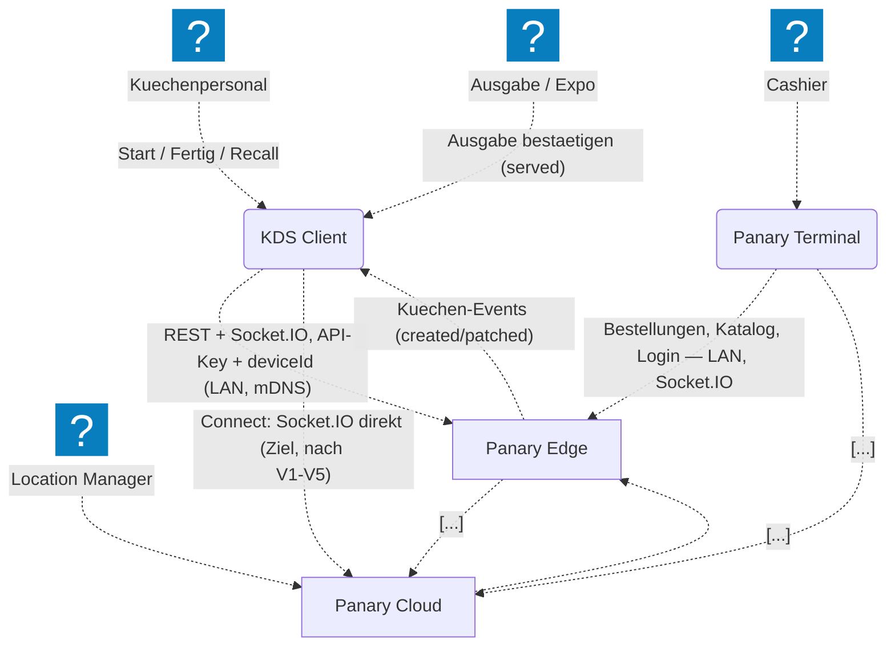

### 1.2 Container — Operate (Pilot)

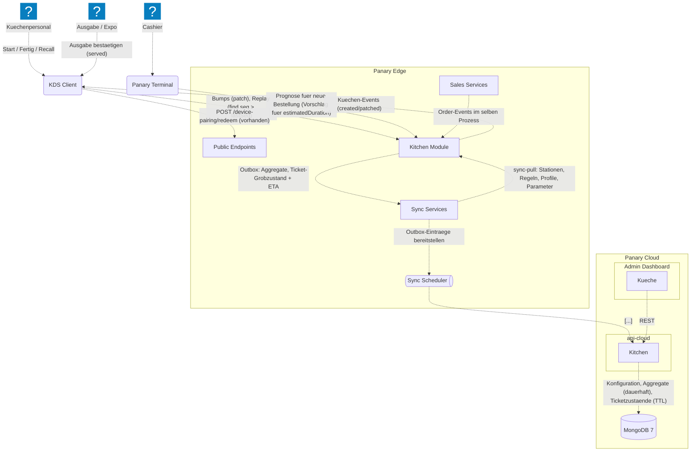

### 1.3 Container — Connect cloud-direkt (Ziel nach V1–V5)

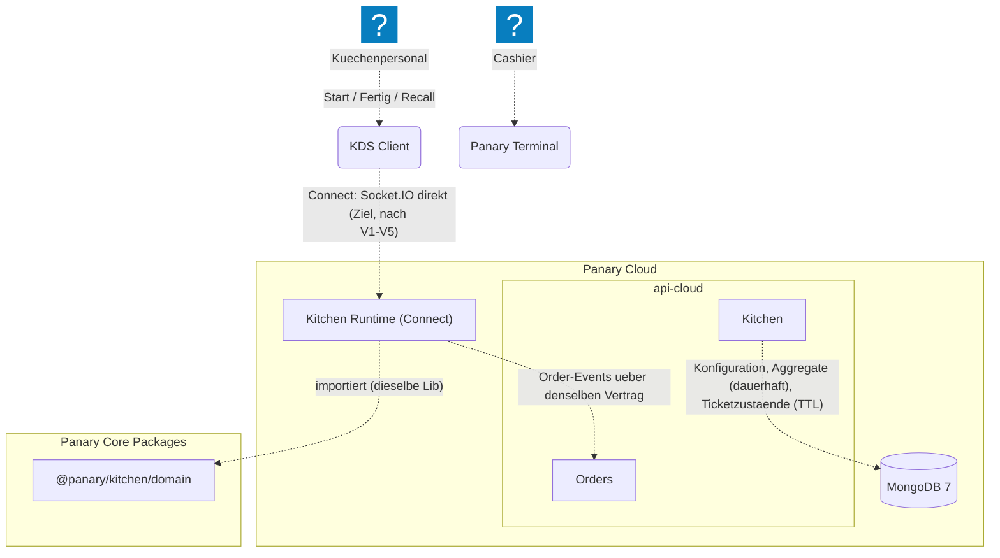

### 1.4 Komponenten des Küchenmoduls

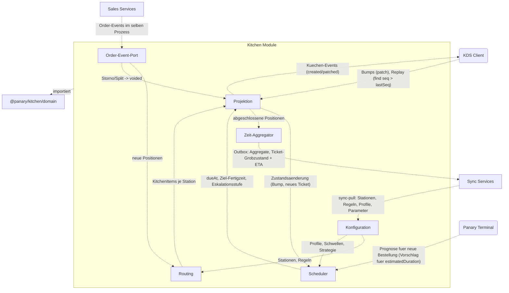

### 1.5 KDS-Client innen

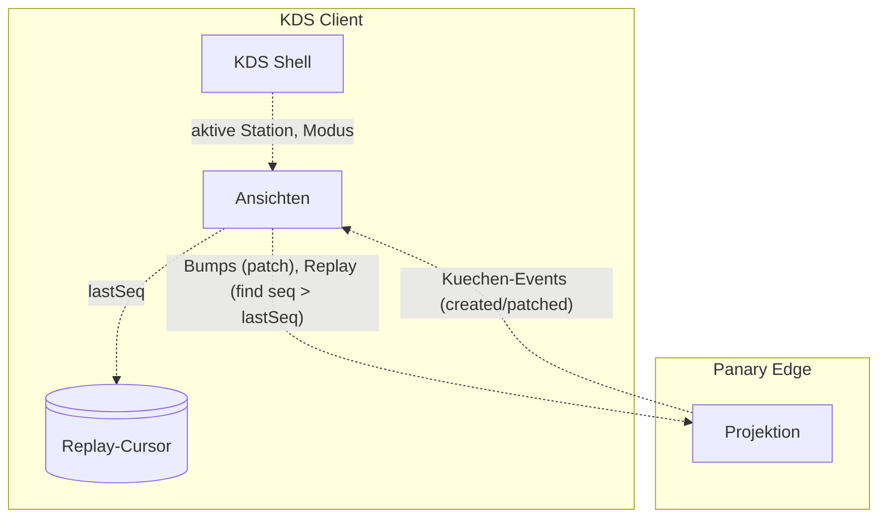

## 2. Vertrag API ↔ Küchenmodul (G1-Leitlinie „separierbar")

Das Küchenmodul berührt die Order-Domäne **nur** über diesen Vertrag. Läuft es später in einem eigenen Prozess, wird der Port vom Funktionsaufruf auf eine Nachricht umgehängt, ohne die Logik umzubauen.

| Richtung | Nachricht | Inhalt | Quelle / Ziel heute |
|---|---|---|---|
| Order → Küche | `order.created` | `orderId`, `settlementScope`, `channel`, `recordingDate`, Positionen aus `effectiveLineItems()` (Produkt, Menge, Modifier, Bundle-Komponenten, `productGroupExternalId`) | after-Hook am `orders`-Service des Edge |
| Order → Küche | `order.statusChanged` | `orderId`, neuer Status (relevant: `aborted`, `completed`) | dito |
| Order → Küche | `order.lineItemsChanged` | `orderId`, neue effektive Positionen (Split, Storno einzelner Positionen) | dito; die Küche berechnet die Differenz selbst |
| Küche → Geräte | `kitchen-items` created/patched | Zustand, `dueAt`, Eskalationsstufe, `seq` | Feathers-Channel der Filiale |
| Küche → Geräte | `kitchen-tickets` patched | Grobzustand, Ziel-Fertigzeit, `estimated \| anchored` | dito |
| Kasse → Küche | `kitchen-forecast` find | Positionen einer geplanten Bestellung → erwartete Fertigzeit (P50/P80) | neuer Lese-Service |
| Küche → Cloud | Outbox `kitchen-ticket-states` | Grobzustand + ETA je Ticket | `recordSyncOutbox` |
| Küche → Cloud | Outbox `kitchen-aggregates` | Produkt × Station × Stunde: Anzahl, Summe, Buckets | dito |
| Cloud → Küche | sync-pull | Stationen, Routing-Regeln, Profile, gelernte Parameter | Sync-Scheduler |

**Regeln:**

- Jede Nachricht trägt `contractVersion`. Änderungen sind nur additiv.
- Das Küchenmodul ist idempotent pro `orderId`: Ein wiederholtes `order.created` erzeugt nichts doppelt.
- Die Küche schreibt nie in `orders`. Das hält G4 (keine Rückspiegelung) technisch ein.

## 3. Abläufe

### Entscheidungen aus dem Durchgang (Michael, 2026-11-01)

Diese Festlegungen gehen den „Offen"-Punkten unter den Diagrammen vor.

| Punkt | Entscheidung |
|---|---|
| Expo-Bump (3.1) | Expo bestätigt `served`, je Station abschaltbar |
| Positionen ohne Küchenbezug (3.1) | `RoutingRule` „nicht ins KDS" für Produktgruppen/-typen. Ohne Regel landet die Position auf der Fallback-Station |
| Anker-Wahl (3.2) | Warteschlange **plus** `prep`. Braucht `capacity` je Station |
| Eskalation (3.2) | Schwellen als Filial-Default mit Überschreibung je Station. `forgotten`-Alarm auf dem Expo, Admin-Glocke erst in v2 |
| Storno (3.3) | Gestartete Positionen muss die Station quittieren, nicht gestartete verschwinden ohne Quittung |
| Recall (3.3) | Station und Expo dürfen zurückholen. Das Ticket fällt von `ready` auf `in-progress` |
| Nachbestellung (3.4) | eigenständig fertig, Expo gruppiert nach `settlementScope` |
| Prognose (3.5) | Die Kasse zeigt **P80** als Vorschlag, übersteuerbar |
| Verbindungsverlust A (3.6) | Bumps sperren, Anzeige mit Hinweis „offline", nach Reconnect Replay |
| Edge-Ausfall C (3.6) | offen, als Risiko R3 nach S5 |

### 3.1 Bestellung → Routing → Stationen → Expo → Abschluss

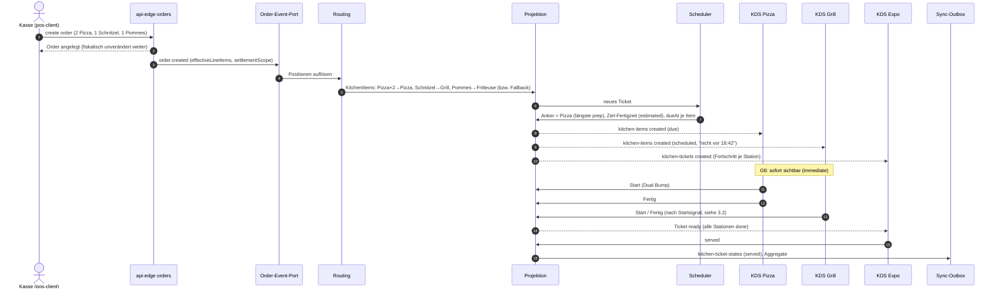

**Offen:**

- Soll Expo `served` bestätigen, oder reicht `ready`? Davon hängt ab, ob der Pilot ohne Expo-Bump arbeiten kann.
- Positionen ohne Küchenbezug, etwa Getränke: Station „keine" oder Ausschluss per Regel?

### 3.2 Anker-Start → Signal an abhängige Stationen → Eskalation

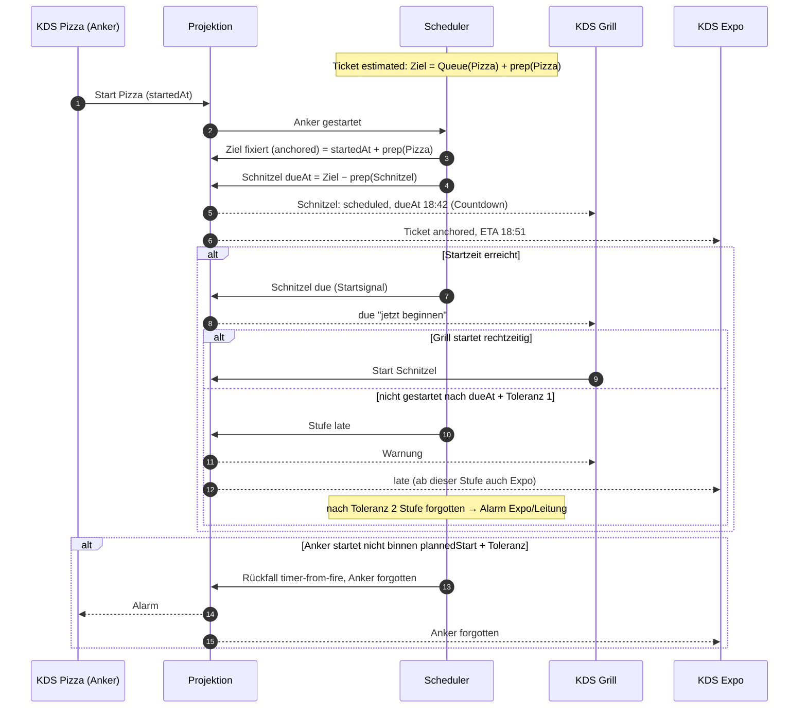

**Offen:**

- **Anker-Wahl bei Kapazität:** Wenn der Ofen voll ist (`capacity`), verschiebt sich der Anker-Start durch die Warteschlange. Zählt dann die Warteschlange oder nur `prep`? Vorschlag aus [ADR 0067](../adr/0067-kds-kuechen-projektion-und-scheduling.md): Warteschlange plus `prep`.
- **Schwellen** für `due-soon`, Toleranz 1 und 2: je Station oder je Filiale?
- **Leitungsalarm:** nur Expo-Bildschirm, oder zusätzlich die Glocke im Admin?

### 3.3 Storno und Split (Void-Propagation)

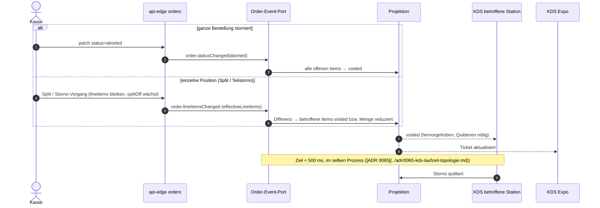

**Offen:**

- Muss eine Station den Storno einer **schon gestarteten** Position quittieren? Vorschlag: ja, mit eigener Farbe. Ware ist eventuell schon in Arbeit, die Info für Verwurf oder Lager kommt von dort.
- **Recall** (fertig gemeldet, aber zurückgeholt): Nur die Station, oder auch das Expo?

### 3.4 Nachbestellung (am Code geprüft)

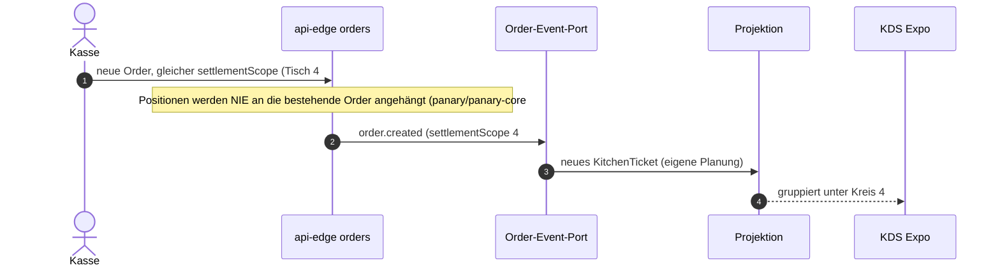

**Offen:** Soll die Nachbestellung auf das erste Ticket warten („zusammen ausgeben") oder eigenständig fertig werden? Vorschlag: eigenständig. Das Expo zeigt die Gruppe.

### 3.5 Prognose-Rückkanal zur Kasse

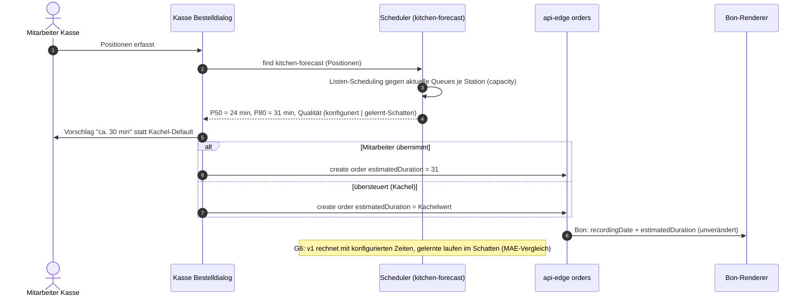

**Offen:**

- Soll die Kasse P50 oder P80 anzeigen? Vorschlag: **P80**. Lieber realistisch als zu optimistisch, das war das 10-gegen-45-Minuten-Problem.
- Wie verhält sich die Kasse ohne KDS? Unverändert Kacheln, weil `kitchen-forecast` dann nicht existiert.

### 3.6 Verbindungsverlust

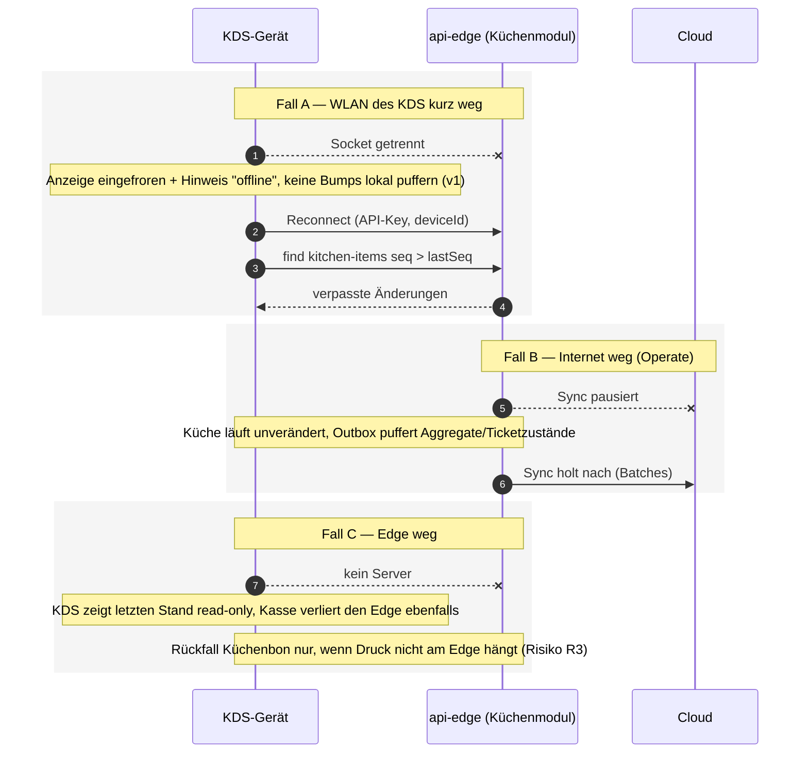

**Offen:**

- **Fall A:** Bumps offline puffern, oder Bump-Tasten sperren? Vorschlag v1: sperren. Puffern erzeugt Konflikte, wenn zwei Geräte dieselbe Station zeigen.
- **Fall C:** Welche Druckwege überleben einen Edge-Ausfall? IP-Drucker laufen über den Print-Server des Edge, MQTT-Drucker publiziert die Tauri-Kasse selbst (ADR 0036). Für S5 als Risiko geführt.

## 4. Zustände

### 4.1 KitchenItem

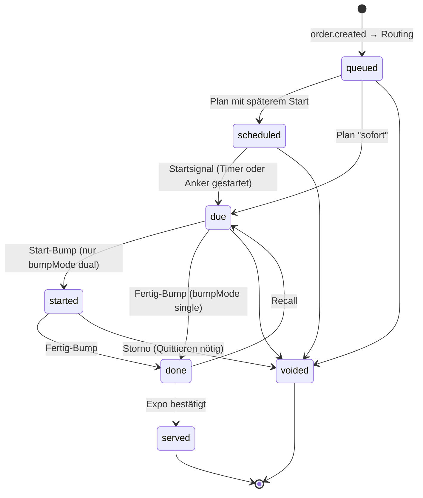

Die Eskalationsstufe ist **kein** Zustand. Sie wird aus `dueAt`, `now` und den Schwellen abgeleitet:

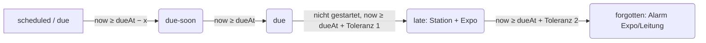

### 4.2 KitchenTicket (Grobzustand, synchronisierter Vertrag, G4)

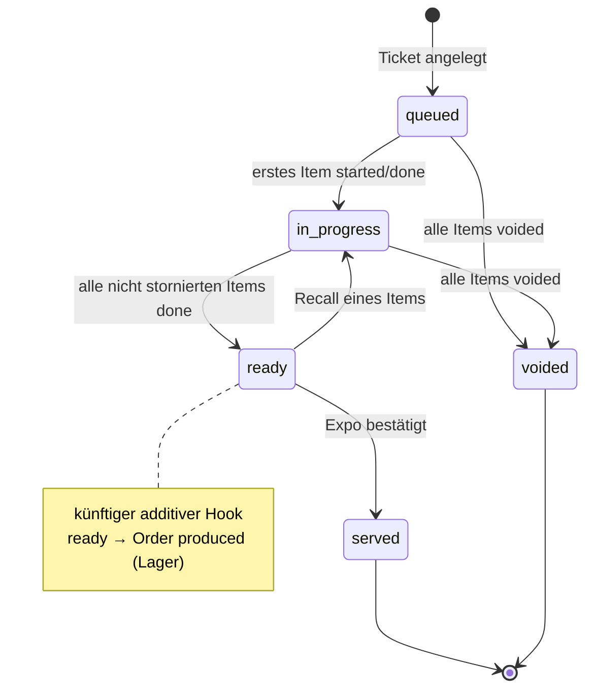

## 5. Entitäten (Übersicht nach S4)

| Entität | Persistiert | Ort | Sync | Schlüsselfelder |
|---|---|---|---|---|
| `Station` | ja | Cloud-Pflege → Edge | pull | `type`, `capacity`, `bumpMode`, `bumpPolicy`, `visibilityPolicy`, `startTrigger`, Schwellen |
| `RoutingRule` | ja | Cloud-Pflege → Edge | pull | Bedingung, Ziel-Station(en), Priorität; Fallback-Station je Filiale |
| `KitchenTicket` | ja | Edge (bzw. Cloud bei Connect) | Grobzustand + ETA → push | `orderId` (1:1), `settlementScope`, Grobzustand, Ziel, `estimated \| anchored` |
| `KitchenItem` | ja, TTL | Edge | **nein** (nur Aggregate) | `ticketId`, `lineItemId`, `stationId`, Zustand, Zeitstempel, `seq` |
| `KitchenAggregate` | ja | Edge → Cloud | push | Produkt × Station × Stunde: n, Summe, Buckets |
| `PrepTimeProfile` | ja | Edge (lokal gelernt) + Cloud-Parameter | pull (Parameter) | konfiguriert, gelernt, n, Streuung |
| `ItemDependency` | nein | Scheduler | — | abgeleitet |

## 6. Ablage

- Das C4-Modell liegt in panary-cloud unter `docs/architecture/c4/model/kds.c4` und `views/kds.c4`. Die C4-Blöcke oben sind daraus erzeugt (Stand 2026-11-01). Bei Abweichung gilt das LikeC4-Modell.
- Die Entscheidungen stehen in ADR 0065–0067, die Umsetzung im [Briefing](kds-v1-briefing.md).
