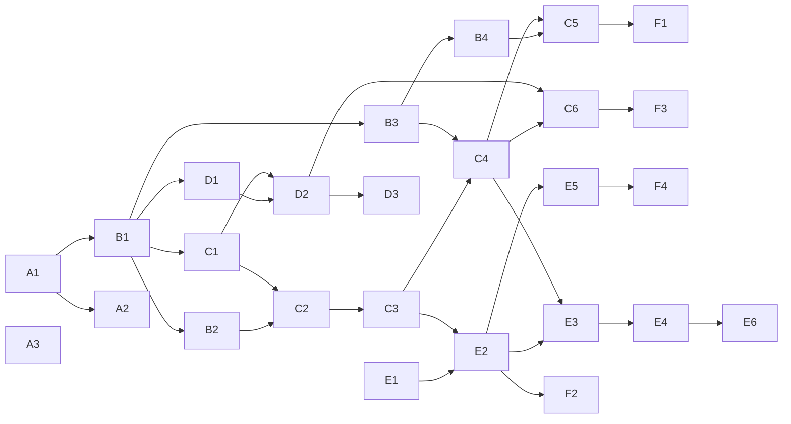

# PNRY-FEAT-KDS-001 — Briefing KDS v1

## 1. Ziel

Das ist der Endzustand von v1:

1. Eine Filiale mit Edge (Operate) betreibt beliebig viele Küchenstationen und eine Ausgabe auf eigenen KDS-Geräten.
2. Die Geräte laufen als Tablet mit Browser, als Sunmi-/Android-Gerät oder als Mini-PC mit Tauri.
3. Bestellungen der Kasse werden nach Regeln auf Stationen verteilt.
4. Die Positionen eines Tickets sind so eingeplant, dass sie gleichzeitig fertig werden (transparent, Anker-Start).
5. Verspätungen eskalieren bis zur Ausgabe.
6. Die Kasse bekommt eine realistische Wartezeit vorgeschlagen (P80).
7. Start- und Fertigzeiten werden gemessen. Gelernte Zeiten laufen im Schatten mit, damit nach 4 Wochen Pilot entschieden werden kann.

Alle Betriebsmodi (Station/Insel, Expo, Linie, All-Day, Single-Screen) sind Konfiguration (G5).

**Nicht in v1:**

- Connect cloud-direkt (G3, Voraussetzungen V1–V5)
- Storefront- und Voice-Bestellungen im KDS
- Bump-Bar
- Rückspiegelung auf den Order-Status
- Admin-Glocke für Küchenalarme
- filialübergreifende Auswertung und Parameter aus der Cloud (G2 Variante c, Stufe 2)

## 2. Grundlagen

| Dokument | Inhalt |
|---|---|
| [Befund (S2)](kds-befund-ist-stand.md) | Ist-Stand mit Belegen, Funde F1–F5 |
| [ADR 0065](../adr/0065-kds-laufzeit-topologie.md) Laufzeit-Topologie | G1: modularer Monolith am Edge, Vertrag API ↔ Küche, Cloud offen |
| [ADR 0066](../adr/0066-kds-repo-zuordnung-und-edge-cloud.md) Repo & Edge/Cloud | G2: Split nach Variante c; G3: Connect nach V1–V5 |
| [ADR 0067](../adr/0067-kds-kuechen-projektion-und-scheduling.md) Domäne & Scheduling | G4–G8: Projektion, Modi, Strategien, eigene App, Pilot-Default |
| [S3-Nachtrag](kds-bewertungen-skalierung-open-core.md) | Cloud-Last, Open-Core-Grenze unter BSL-1.1, Rückspiegelung |
| [S4 Architektur & Abläufe](kds-architektur-und-ablaeufe.md) | C4 (LikeC4), Vertrag, Sequenz- und Zustandsdiagramme, Entscheidungen aus dem Durchgang |

## 3. Entscheidungsstand

| Thema | Status | Wo |
|---|---|---|
| G1 Topologie | **entschieden**: Edge B. Cloud **vertagt** bis Erfahrung mit dem Edge | [ADR 0065](../adr/0065-kds-laufzeit-topologie.md) |
| G2 Repo / Open Core | **entschieden**: Split, Variante c | [ADR 0066](../adr/0066-kds-repo-zuordnung-und-edge-cloud.md) |
| G3 Connect | **entschieden**: Ziel, **vertagt** bis V1–V5 | [ADR 0066](../adr/0066-kds-repo-zuordnung-und-edge-cloud.md) |
| G4 Projektion | **entschieden**: eigene Projektion, Ticketzustand und ETA synchronisiert, keine Rückspiegelung | [ADR 0067](../adr/0067-kds-kuechen-projektion-und-scheduling.md) |
| G5 Umfang | **entschieden**: alle Modi in v1 | [ADR 0067](../adr/0067-kds-kuechen-projektion-und-scheduling.md) |
| G6 Smart | **entschieden**: messen, im Schatten lernen, Umschalten nach Metrik | [ADR 0067](../adr/0067-kds-kuechen-projektion-und-scheduling.md) §7 |
| G7 App | **entschieden**: eigene App `apps/kds-client` | [ADR 0067](../adr/0067-kds-kuechen-projektion-und-scheduling.md) |
| G8 Default | **entschieden**: `immediate` + `anchor-started`, Rückfall Timer | [ADR 0067](../adr/0067-kds-kuechen-projektion-und-scheduling.md) |
| Ablauf-Details | **entschieden** (10 Punkte) | S4 §3 |
| Druckweg bei Edge-Ausfall | **offen** → R3 | S4 §3.6 |
| Flag-Gate | **entschieden** (Michael, 2026-11-01): Cloud-Flag `kitchenDisplayRollout` plus Konfigurations-Gate, kein Flag am Edge | §7 |
| Lesart der BSL-1.1 | **Spezialist nötig** (Jurist), nicht blockierend | [S3-Nachtrag](kds-bewertungen-skalierung-open-core.md) §2 |
| Küchen-UX (Handschuhe, Abstand, Kontrast) | **Spezialist sinnvoll** (Test vor Ort beim Piloten) | AP 3.3 |
| Sunmi-KDS-Hardware | **offen**: Modell und Beschaffung durch Michael | R5 |

## 4. Arbeitspakete

Jedes Paket hat PR-Größe und wird ein eigenes Issue (Label `planned`). Repo-übergreifende Abhängigkeiten werden als GitHub-Relationen gesetzt (`wt.sh beziehung … --blocked-by`).

**Vorschlag:** Ein **Anker-Issue** „KDS v1" in core trägt alle Pakete als Unter-Issues.

### Stufe A — Grundlage (vor jeder Umsetzung)

| Nr | Repo | Paket | Akzeptanzkriterien | wartet auf |
|---|---|---|---|---|
| A1 | core | **ADRs ablegen** (001–003 nach `docs/adr/`, Nummern per `pnpm docs:adr:next`), Befund und S4-Dokument als OKF-Seiten, Log-Fragment | Doku-Gates grün. ADR-Index generiert. Verweise auf panary/panary-core#1264 | — |
| A2 | cloud | **LikeC4-Modell** `model/kds.c4` und `views/kds.c4`, Eintrag in `c4/index.md` | `likec4 validate` grün. Alle KDS-Elemente `#planned` | A1 |
| A3 | core | **Bug panary/panary-core#1264**: Kasse zeigt `production` als „storniert" | wie im Issue | — |

### Stufe B — Domäne in core (reine Logik, ohne I/O)

| Nr | Repo | Paket | Akzeptanzkriterien | wartet auf |
|---|---|---|---|---|
| B1 | core | **`libs/domains/kitchen/domain` anlegen** (Nx-Generator, Tag `publishable`). Schemas für `Station`, `RoutingRule`, `KitchenTicket`, `KitchenItem`, `KitchenAggregate`, `PrepTimeProfile` und Vertragstypen mit `contractVersion` | Lib baut und wird veröffentlicht. Schemas validieren Grenzwerte (maxLength, maxItems). Ein Lint-Gate verbietet Importe `orders → kitchen` und lässt `kitchen → orders` nur für Typen zu | A1 |
| B2 | core | **Routing** (reine Funktion): Position → Station(en), Bundle-Komponenten einzeln, Regel „nicht ins KDS", genau eine Fallback-Station | Tabellentests: keine Position geht verloren. Leere Regelmenge → alles auf Fallback. Ausschlussregel greift | B1 |
| B3 | core | **Scheduler** (reine Funktion `plan(state, now, profiles)`): Strategien `fifo`, `fire-by-prep-time`, `anchor-started` mit Warteschlange + `prep` und `capacity`, deterministischer Gleichstand, Rückfall Timer, Eskalationsstufen | Replay-Tests aus Ereignisfolgen ergeben dasselbe Ergebnis. Rückfall nach Toleranz. Eskalation `due-soon/late/forgotten` je Schwelle | B1 |
| B4 | core | **Schätzer und Prognose**: P50/P80 je Profil, Mindeststichprobe, Ausreißerfilter, Schätzung im Single-Bump-Modus markiert; Prognose für neue Bestellungen per Listen-Scheduling | Unter Mindeststichprobe wird der konfigurierte Wert genutzt. Ausreißer werden verworfen und gezählt. Prognose steigt mit der Warteschlange | B3 |

### Stufe C — Edge-Laufzeit in core

| Nr | Repo | Paket | Akzeptanzkriterien | wartet auf |
|---|---|---|---|---|
| C1 | core | **Konfigurations-Entitäten am Edge**: Migrationen, Services `kitchen-stations`, `kitchen-routing-rules`, `prep-time-profiles` als sync-pull-Ziele (Pflege nur in der Cloud) | gegen die **migrierte** SQLite getestet (Memory `feedback-edge-db-logik-gegen-migrierte-sqlite-testen`). Pull legt an und aktualisiert idempotent | B1 |
| C2 | core | **Projektion + Order-Event-Port**: after-Hooks an `orders` → Port. `kitchen-tickets` (1 je Order, `settlementScope`) und `kitchen-items` mit `seq` je Filiale. Storno/Split über `effectiveLineItems()` | Ein doppeltes `created` erzeugt nichts doppelt. Storno markiert alle offenen Items `voided`. Teilstorno reduziert. Die Küche schreibt nie in `orders` | B2, C1 |
| C3 | core | **Echtzeit und Rechte**: Publish nur an KDS- und Kassen-Verbindungen der Filiale, `DEVICE_KDS` in der Rechtematrix für die neuen Services, `serviceEvents`-Regel, Replay per `find({ seq > n })` | Ein Gerät einer anderen Filiale bzw. eines anderen Tenants bekommt nichts (Test). Replay liefert lückenlos | C2 |
| C4 | core | **Scheduler-Laufzeit**: Bump-Endpunkte (Start, Fertig, Recall, Served, Storno-Quittung), Anker-Fixierung als Event, Zeitgeber für `due` und Eskalation, begrenzt und fehlerfest | Storno → Gerät < 500 ms (lokal gemessen). Ein Fehler im Scheduler beendet `api-edge` nicht | B3, C3 |
| C5 | core | **Prognose-Service** `kitchen-forecast` (find, nur lesend) | Antwort ohne Konfiguration → leer, die Kasse fällt auf Kacheln zurück | B4, C4 |
| C6 | core | **Outbox**: `kitchen-ticket-states` (Grobzustand + ETA) und `kitchen-aggregates` (Produkt × Station × Stunde), ohne Personenbezug. TTL für Rohdaten der Items | Outbox-Einträge koaleszieren. Kein `userId` in den Aggregaten (Test). TTL-Lauf löscht nur ältere Rohdaten | C4 |

### Stufe D — Cloud

| Nr | Repo | Paket | Akzeptanzkriterien | wartet auf |
|---|---|---|---|---|
| D1 | cloud | **Pin-Bump** auf das core-Release mit B1 | Typecheck-Gate grün | B1 + core-Release |
| D2 | cloud | **api-cloud `svcKitchen`**: Konfigurations-Services mit Multi-Tenancy, sync-pull-Quelle, Push-Ziele in der Sync-Allowlist (`kitchen-ticket-states`, `kitchen-aggregates`), TTL-Index für Ticketzustände. **Flag `kitchenDisplayRollout`** (Registry, Defaults laut CLAUDE.md) im selben Commit, gatet die Auslieferung der Konfiguration per Sync | Felddeklarationen beidseitig (Memory `feedback-sync-felddeklarationen`). Cloud-only-Felder gesperrt. Mongo-Gate ohne neue Rohzugriffe. Ohne Flag keine Pull-Daten | D1, C1 |
| D3 | cloud | **Admin-UI „Küche"**: Stationen (alle Felder inkl. `bumpMode`, Sichtbarkeit, Start-Trigger, Schwellen), Routing-Regeln, **Vorlagen** (Insel+Ausgabe, Linie, Ein Bildschirm), Warnung „über Fallback geroutet" | hinter dem Flag aus D2 (§7). Vorlagen erzeugen gültige Konfigurationen. Signal Forms | D2 |

### Stufe E — KDS-Client in core (eigene App, G7)

| Nr | Repo | Paket | Akzeptanzkriterien | wartet auf |
|---|---|---|---|---|
| E1 | core | **Geteilte Geräte-Libs** aus dem pos-client lösen: Pairing, Hub-Discovery, Gerätekonfiguration, UI-Skalierung, soweit noch nicht in `libs/` | Der pos-client verhält sich unverändert (bestehende Tests grün). Kein Rückimport aus der App | — |
| E2 | core | **`apps/kds-client` anlegen** (Nx-Generator): Shell, Pairing als Typ `kds`, Stationswahl, Modus aus der Station-Konfiguration; Browser-Build | Gerät koppelt am Edge und sieht seine Station. Läuft im Browser ohne Hülle | E1, C3 |
| E3 | core | **Stationsansicht**: Tickets mit Kontext der anderen Stationen, Dual/Single Bump, Countdown „nicht vor", Eskalationsfarben, Storno-Quittung, Recall, Offline-Sperre + Replay | Alle Zustände aus S4 §4.1 sichtbar. Offline sperrt Bumps. Reconnect zeigt verpasste Änderungen | E2, C4 |
| E4 | core | **Expo-Ansicht**: Fortschritt je Station, Gruppierung nach `settlementScope`, `served`, Recall, `late/forgotten`-Alarm | Ticket `ready` erst, wenn alle nicht stornierten Items fertig sind. Alarm sichtbar | E3 |
| E5 | core | **Hüllen und Release-Kanal**: Tauri- und Capacitor-Konfiguration, eigene APK, eigener Tag-Kanal (Vorschlag `kds-v*`), Build-Workflow | Je eine installierbare Version für Tauri und Android aus CI | E2 |
| E6 | core | **Linie, All-Day, Single-Screen** (Übergabe-Regel Linie, Summenansicht, Ein-Bildschirm-Betrieb) | Je ein Durchlauf pro Modus in der Sandbox | E4 |

### Stufe F — Kasse und Pilot

| Nr | Repo | Paket | Akzeptanzkriterien | wartet auf |
|---|---|---|---|---|
| F1 | core | **Prognose-Vorschlag im Bestelldialog**: P80 aus `kitchen-forecast` als Vorschlag für `estimatedDuration`, übersteuerbar | Ohne KDS bleiben die Kacheln unverändert. Mit KDS steigt der Vorschlag, wenn sich die Warteschlange füllt | C5 |
| F4 | workbench | **Release-Kanal im Werkzeug**: `kds-v*` und `apps/kds-client` in `core_release_kanaele` (`scripts/wt.sh`), damit `verify` und Sichttests den richtigen Tag nennen | `wt-selftest.sh` grün. `verify` nennt für einen kds-client-PR den `kds-v*`-Kanal | E5 (Kanalname) |
| F2 | workbench | **Sandbox-Erweiterung**: KDS-Client und Küchen-Seed (3 Stationen + Ausgabe wie beim Piloten) in `scripts/sandbox.sh` | Sichttests von E3/E4 laufen in der Sandbox | E2 |
| F3 | core | **Pilot-Messung**: Auswertung nach 4 Wochen (MAE Kachel / konfiguriert / gelernt, Anteil Positionen mit beiden Zeitstempeln), Entscheidung G6-Umschaltung | Bericht mit Zahlen. Entscheidung dokumentiert ([ADR 0067](../adr/0067-kds-kuechen-projektion-und-scheduling.md) nachgezogen) | C6, Pilotbetrieb |

### Reihenfolge und Pilot-Pfad

G5 („alle Modi in v1") bleibt unberührt. Die Reihenfolge stellt nur sicher, dass der Pilot so früh wie möglich startet:

- **Pilot-Start:** A → B1–B4 → C1–C5 → D1–D3 → E1–E5 → F1, F2, F4
- **Release-Reihenfolge (zwingend):** Der cloud-Stand mit D2 muss **auf Staging bzw. Prod laufen, bevor** ein Edge-Release mit C1 oder C6 ausgeliefert wird. Sonst finden Pull-Abfragen keinen Service, und Outbox-Pushes neuer Entitäten werden abgelehnt. Eine abgelehnte Outbox ist endgültig und still (TERMINAL). Gleiches Muster wie bei der PIN-Pflicht: „Release Cloud VOR core".
- **v1 vollständig:** zusätzlich E6 und C6
- **nach 4 Wochen Pilot:** F3

**Was parallel laufen kann** (je Repo höchstens ein nx-Lauf gleichzeitig, Regeldatei §3):

- B2 und B3 parallel.
- Die cloud-Pakete D1–D3 parallel zu C und E.
- E1 ab sofort, unabhängig von B.
- A3 jederzeit.

## 5. Risiken

| Nr | Risiko | Wirkung | Gegenmaßnahme |
|---|---|---|---|
| R1 | **Umfang vs. Pilot in ~3 Monaten.** Alle Modi (G5) und eine eigene App mit Hüllen, APK und Release-Kanal (G7) sind mehr als der ursprüngliche Vorschlag | Pilot verzögert sich | Pilot-Pfad oben. E6 und C6 nach Pilot-Start. Fortschritt über die Karte (`wt.sh karte`) |
| R2 | Mitarbeiter bumpen nicht konsequent | schlechte Messdaten, falsche Prognose | Quote „Positionen mit beiden Zeitstempeln" im Pilot. Single-Bump-Modus. Ausreißerfilter |
| R3 | **Edge-Ausfall**: Küche und Kasse ohne Server; IP-Küchendrucker hängen am Print-Server des Edge, MQTT-Drucker an der Tauri-Kasse | kein Rückfall auf Papier | vor dem Pilot klären, welcher Druckweg beim Piloten verfügbar ist. Gegebenenfalls eigenes Issue „Küchenbon-Rückfall" |
| R4 | Die Lib-Grenze `kitchen` ↔ `orders` erodiert (core-Boundaries sind offen) | späterer Auszug wird zum Umbau | Lint-Gate in B1 |
| R5 | Hardware noch nicht beschafft (Sunmi-KDS, Tablet, Mini-PC) | E5 unprüfbar | früh ein Testgerät je Hülle beschaffen. Browser-Build als erste Lieferform |
| R6 | Neue Sync-Entitäten (Konfiguration, Ticketzustände, Aggregate) | stille Ablehnung am Push (TERMINAL), Feld-Drift | Release-Reihenfolge cloud (D2) vor core-Edge (C1/C6). Felddeklarationen beidseitig, Tests gegen die echten Allowlists |
| R7 | Vorratsartikel (Pommes auf Vorrat) verfälschen die Messung | gelernte Zeiten zu kurz | Station- oder Produktoption „nicht messen" in B4/C1 |
| R8 | Cloud-Last bei späterem Connect | Ausfall aller Connect-Küchen bei Deploy/OOM | nicht v1. Lastmessung V3 vor Freigabe ([ADR 0066](../adr/0066-kds-repo-zuordnung-und-edge-cloud.md)) |
| R9 | Single-Instance-Ausfall der Cloud | nur Konfiguration und Auswertung betroffen, Küche am Edge läuft weiter | — (für v1 akzeptiert) |

## 6. Definition of Done (je Paket und für v1)

**Je Paket:**

- PR klein, `Closes`/`Refs` laut Regeldatei §2.5.
- Gates grün: Format, Lint, Test, Typecheck und Build, dazu die repo-eigenen Gates (Mongo, Empty-Targets, Doku).
- Doku im selben Commit: OKF-Seite oder ADR-Nachtrag, Ordner-Index und Log-Fragment.
- Neue Services in Rechtematrix, Multi-Tenancy-Hooks und Publish-Regeln eingetragen.
- Sichttest-Issue nach dem Merge. core in der Sandbox.

**v1 gilt als fertig, wenn:**

- alle Pakete außer F3 gemergt sind,
- ein Durchlauf in der Sandbox mit drei Stationen und Ausgabe alle Abläufe aus S4 §3 zeigt,
- die Kasse den P80-Vorschlag zeigt,
- und der Pilot läuft.

## 7. Feature-Flag- und Tarifvorschlag

- **Flag (cloud)** `kitchenDisplayRollout`
  - Defaults laut panary-cloud CLAUDE.md: `defaultEnabled: false`, Ablauf in 3 Monaten, `in-development`.
  - Gatet die Admin-UI „Küche" und die Auslieferung der Küchen-Konfiguration per Sync.
- **Edge ohne eigenes Flag** (entschieden):
  - Der Edge kann laut cloud ADR 0024 keine Flags auswerten.
  - Das KDS am Edge ist aktiv, **sobald eine Küchen-Konfiguration vorliegt**. Die kommt nur bei aktivem Flag.
  - Damit ist ein Flag-Sync an den Edge (ADR 0024 §15) für v1 nicht nötig.
- **Schalter für gelernte Zeiten:** kein Flag, sondern Strategie-Konfiguration je Station (`smart-learned`). Freigabe nach F3.
- **Tarif v1:** wie in ADR 0006, Operate (`offlinePos`) — physischer Betrieb mit Edge.
- **Tarif Ziel:** eigener Plan-Key `kitchenDisplay`, entkoppelt von `offlinePos` (Muster `fiscalCashier`), mit der Connect-Freigabe (V1 aus [ADR 0066](../adr/0066-kds-repo-zuordnung-und-edge-cloud.md)).
- Das „ganze Gehirn in jedem Plan" bleibt gewahrt: Die Planungslogik ist in jedem Plan dieselbe, der Tarif bestimmt nur die Betriebsart.

## 8. Folge-Issues außerhalb von v1 (vormerken, nicht anlegen)

- **Connect cloud-direkt:**
  - V1 Teilrevision ADR 0006 (`kitchenDisplay`)
  - V2 Pairing-Gate
  - V3 Lastmessung
  - V4 Replay in der Cloud
  - V5 Klärung „Cloud-POS"
  - danach G1-Cloud-Entscheidung (Modul oder eigener Dienst)
- **Cloud-Intelligenz (G2 c):** Kaltstart-Zeiten, Tageszeit-Muster, Benchmarks, Parameter an den Edge.
- **Storefront und Voice:** Prognose und Ticketzustand als Leser.
- **Rückspiegelung** `ready → produced` (Voraussetzung panary/panary-core#1264).
- **Weitere Ausbaustufen:** Bump-Bar, Admin-Glocke für Küchenalarme, Abholtafel.

## 9. Übergang in den Workflow

Das Briefing ersetzt keine Issues. Nach Freigabe wird je Paket ein Issue nach Regeldatei §1 angelegt (`/plan-issue`, Prüfung durch `plan-reviewer`):

- Label `planned`
- Verifikationsabschnitt
- Plan-Stand-SHA
- Relationen: Anker als Parent, blocked-by laut Graph oben

Umgesetzt wird über `/issue-start` in eigenen Worktrees. A1 und A2 bringen die Planungsartefakte in die Repos.
